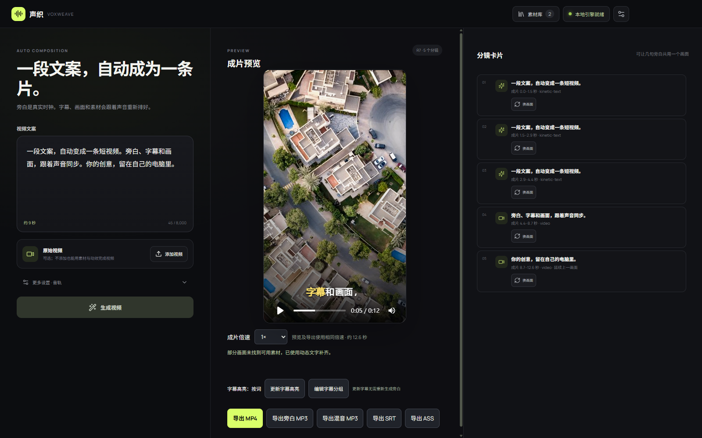
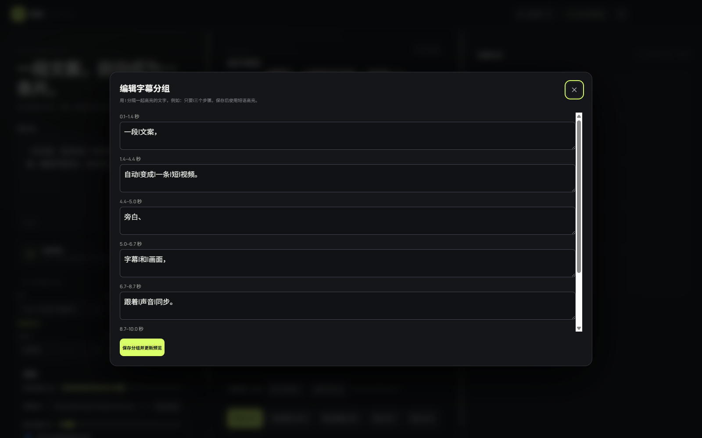
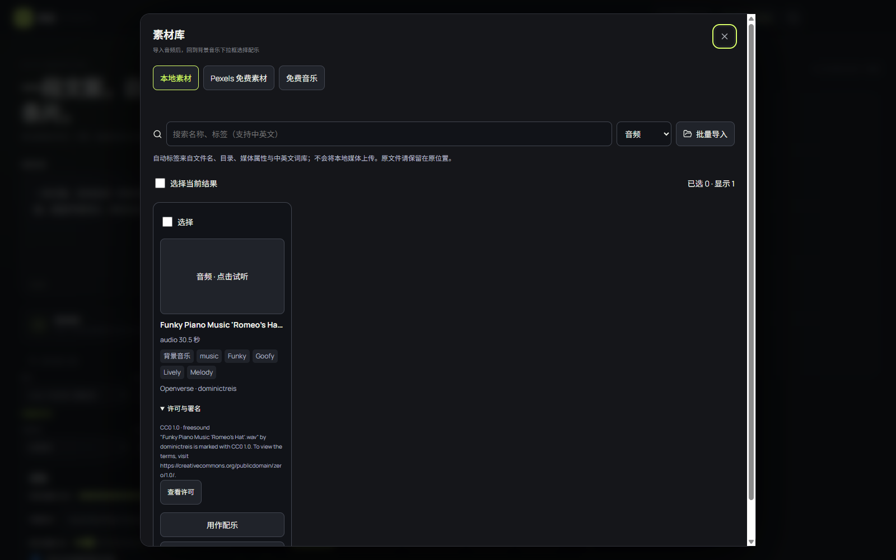
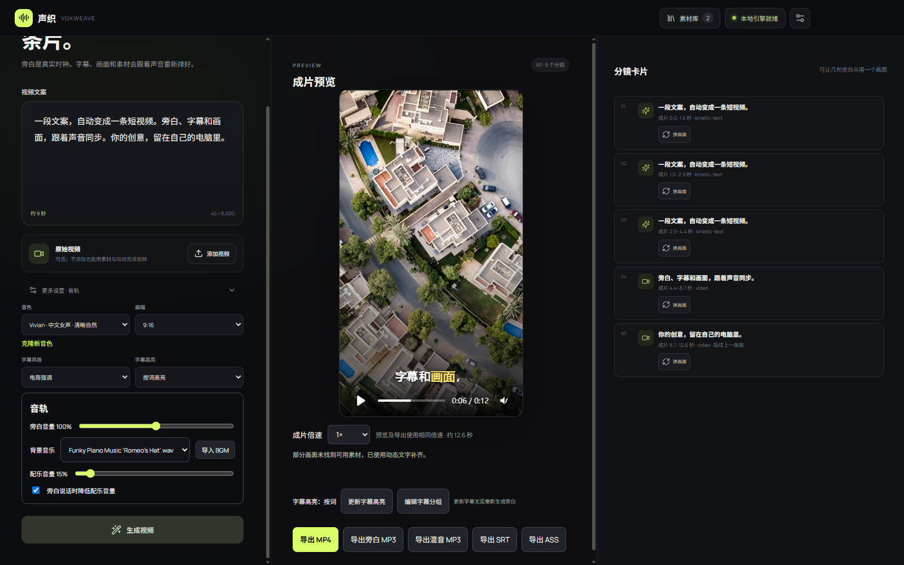

<div align="center">


# LocalVideoFactory

### Your local AI short-video factory. Script in. Video out.

**AI storyboarding · Multimodal clip selection · Voice cloning · Dynamic captions · B-roll · Open music**

One desktop workflow from your script to a previewable, editable MP4.

[简体中文](README.md) · [English](README.en.md) · [Run the latest source](docs/building.md) · [Past releases](https://github.com/hafung/LocalVideoFactory/releases) · [Issues](https://github.com/hafung/LocalVideoFactory/issues)

[](https://github.com/hafung/LocalVideoFactory/actions/workflows/ci.yml)
[](package.json)
[](docs/building.md)
[](#a-local-ai-production-stack)
[](LICENSE)

</div>



**LocalVideoFactory** is an open-source desktop app for automated short-video production. Write a product pitch, explainer, or commentary script, optionally add a source video, and let a local pipeline organize narration, captions, footage, music, and rendering. Preview the result, adjust individual scenes, and export an MP4.

The desktop app is **声织 VoxWeave**. This repository was renamed from `VoxWeave` to `LocalVideoFactory`; existing project storage, voice profiles, CLI commands, and installer names retain their compatible identifiers.

> **Version:** this page describes the current v0.2.8 source. The latest published installer is still v0.2.1 and predates these screenshots. [Build the current source](docs/building.md) to use the features shown here.

## A production line, from script to screen

```text
Script + optional source video
          ↓
Local AI storyboarding and visual search intent
          ↓
TTS narration → audio-driven timing → SenseVoice caption alignment
          ↓
Content-matched source clips / local B-roll / Pexels / motion typography
          ↓
Word or phrase highlights + narration / original audio / BGM mix
          ↓
Preview → scene-card and caption edits → MP4 / MP3 / SRT / ASS
```

## A studio-sized workflow on your own computer

| Capability | What it does |
| --- | --- |
| 🧠 **AI storyboarding** | Local Qwen3.5-4B turns script segments into visual intent and media search terms. |
| 👁️ **Multimodal source selection** | Sampled-frame understanding, source speech, and speech/shot boundaries help select footage that matches the narration. |
| 🎙️ **Narration and voice cloning** | Qwen3-TTS 1.7B generates speech locally; reference audio produces reusable `.qvoice` profiles. |
| ⏱️ **Audio-driven timing** | Real narration duration determines scene and caption timing, with visible estimated-timing fallback when alignment is unavailable. |
| 🎞️ **Automatic B-roll** | Prefer local or Pexels video, use short image holds, and fill remaining gaps with motion typography. |
| ✨ **Dynamic captions** | Four visual styles, word/phrase highlights, editable groups, and SRT/ASS exports. Caption edits reuse the narration. |
| 🎵 **Open music discovery** | Search, preview, download, and select Openverse music. CC0 by default; optional CC BY, with credits and source metadata preserved. |
| 🎚️ **Three-source audio mixing** | Separate narration, source-audio, and BGM levels, plus automatic background ducking during speech. |
| 🗂️ **Scene-card editing** | Replace one scene or a group of sentences, preview candidates, and choose another range from the same video. |
| 📦 **Deliverable exports** | H.264/AAC MP4, narration/mixed MP3, SRT, and ASS; output speed applies consistently to video, audio, and captions. |

AI storyboarding and multimodal analysis require Qwen3.5-4B and its matching vision projector. Missing resources trigger visible fallbacks. See [model setup](docs/building.md#本地模型与运行时).

## Preview it. Shape it. Ship it.

### Script, preview, and storyboard in one workspace

Create in **9:16, 16:9, or 1:1**, inspect the result, then refine the scenes that need attention. Related sentences can share one continuous visual.

### Captions with a sense of rhythm



Choose commerce, commentary, minimal-brand, or info-card styling. Highlight words or phrases, and use `|` to adjust groups after generation without synthesizing the narration again.

### Discover music without leaving the project



Open **更多设置 → 音轨 → 导入 BGM → 免费音乐** in the current Chinese-language UI. Search, listen, and download—or select **用作配乐** to choose the track as BGM. Press **生成视频** to apply your audio changes.

### Keep the voice clear and the atmosphere alive



Adjust narration, original audio, and music independently. For source-video projects, enable **保留原视频声音** after a preview exists. Source audio follows selected source segments and can remain when their visuals are replaced. Audio-only changes reuse existing narration and scene choices.

Screenshots were captured from the real Windows application and a generated demo project. [Screenshot and sample-media notes](docs/screenshots/README.md).

## Make your first video

1. **Prepare the app and media.** [Run the current source](docs/building.md), prepare the models you need, and import local assets. Pexels requires an API key; Openverse music search works without entering one.
2. **Write a script and generate.** A source video is optional. The app can assemble local media, online assets, and motion typography.
3. **Preview, refine, and export.** Replace visuals, adjust captions, select music, apply changes, and export MP4 or separate audio/subtitle files.

## A local AI production stack

**Local inference, optional online discovery.** Script understanding, source analysis, voice cloning, narration, and alignment run on your computer. Online media searches send search terms to their respective providers. Once models and local assets are ready, the core workflow can run offline.

| Component | Role |
| --- | --- |
| **Qwen3.5-4B + vision projector / llama.cpp** | Storyboarding and sampled-frame understanding of source video |
| **Qwen3-TTS 1.7B / native C runtime** | CPU narration and reference-voice extraction; INT8, INT4, and BF16 support |
| **SenseVoice + Silero VAD** | Source transcription, speech segmentation, and caption alignment |
| **Qwen3 Embedding 0.6B** | Semantic ranking of existing media names, tags, and descriptions |
| **HyperFrames + FFmpeg** | Preview, rendering, audio mixing, and video export |
| **SQLite + Pexels + Openverse** | Local indexing, online visual assets, and openly licensed music |

Current desktop distribution and launch scripts target **Windows x64**. A discrete GPU is optional; CPU processing time and memory needs depend on the models and input length. Initial model preparation and online discovery require internet access.

Visuals come from source footage, media libraries, online assets, and motion-graphics templates. Automatic library tags use text and rules; pixel analysis belongs to the optional multimodal source-video pipeline.

## Develop and build

```bash
git clone https://github.com/hafung/LocalVideoFactory.git
cd LocalVideoFactory
pnpm install
pnpm typecheck
pnpm test
pnpm build
```

Run the current application from Windows PowerShell after preparing its resources:

```powershell
.\scripts\run-local-windows.ps1
```

See the [build and run guide](docs/building.md) for model setup, Windows/WSL development, installers, portable builds, and the narration CLI.

[Product specification](docs/product-spec.zh-CN.md) · [Development notes](docs/development.zh-CN.md) · [SenseVoice CLI](tools/sensevoice-cli/README.md) · [Dependency licenses](LICENSES.md)

## Contribute to the production line

Bring your bug reports, example projects, caption templates, retrieval improvements, and performance findings. Include a version, reproduction steps, and relevant logs in an Issue. Use substitute media when a project contains private material.

If you'd like your own computer to handle the work after writing the script, try it, star it, and help build it.

## License and acknowledgements

Application code uses the [MIT License](LICENSE). Models, the native engine, FFmpeg, fonts, and other dependencies retain their own licenses; see [LICENSES.md](LICENSES.md). Online assets follow their source licenses. CC BY requires appropriate attribution, a license link, and an indication of changes.

Obtain the speaker's permission before cloning a voice, and follow applicable laws and platform AI disclosure rules when publishing.
